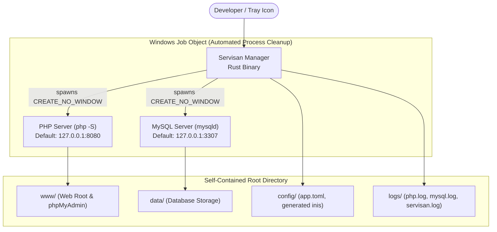

<div align="center">


# Servisan

**Ultra-lightweight, portable, and blazing-fast local PHP + MySQL server manager for Windows, crafted in Rust.**

[](CHANGELOG.md)
[](https://github.com/Haniel26/servisan)
[](https://www.rust-lang.org)
[](LICENSE)
[](#-why-servisan-vs-alternatives)
[](#-architecture)

[Key Features](#-key-features) •
[Why Servisan?](#-why-servisan-vs-alternatives) •
[Architecture](#-architecture) •
[Quick Start](#-quick-start) •
[CLI Reference](#-cli-reference) •
[Configuration](#-default-configuration) •
[Roadmap](#-roadmap) •
[Changelog](CHANGELOG.md)

</div>

---

## 💡 What is Servisan?

**Servisan** is a modern, high-performance, and completely portable alternative to legacy local server environments like Laragon and XAMPP. Built from the ground up in **Rust**, it orchestrates native **PHP** and **MySQL/MariaDB** runtimes inside a self-contained directory with zero Windows registry pollution, instant startup, and foolproof process cleanup.

The name blends **Server** + Laravel's **Artisan**, while paying homage to the Indonesian term *"servisan"*—a finely tuned, reliable mechanism.

---

## ✨ Key Features

* 🚀 **Blazing Fast & Featherweight:** Manager executable starts in under 100ms with a baseline memory footprint of **< 15 MB RAM**.
* 🛡️ **Zero Zombie Processes:** Controlled via native **Windows Job Objects** (`JOB_OBJECT_LIMIT_KILL_ON_JOB_CLOSE`). If Servisan exits, stops, or crashes, child PHP/MySQL processes are reaped cleanly—no lingering background instances locking ports.
* 📦 **100% Portable & Isolated:** Data (`data/`), logs (`logs/`), configurations (`config/`), and projects (`www/`) live strictly inside the Servisan folder. Put it on a USB drive or move folders freely without reconfiguring.
* 🎛️ **Silent System Tray (No Window / No Black Console):** Runs unobtrusively in the Windows notification area (near the clock) with dynamic status indicators (🟢 running / ⚪ stopped). Never clutters your taskbar with open windows or black terminal popups.
* 🔀 **Conflict-Free Ports by Default:** Defaults to PHP **8080** and MySQL **3307** so you can run Servisan side-by-side with Laragon, Docker, or IIS without port clashes.
* 💻 **Built-in Developer Shell:** `servisan shell` immediately launches your terminal with Servisan's portable `php`, `mysql`, and `mysqladmin` injected directly into `PATH`.
* 🗄️ **phpMyAdmin Ready:** One command (`servisan phpmyadmin install`) imports and configures a managed phpMyAdmin dashboard with automated blowfish secret generation.

---

## 📊 Why Servisan vs Alternatives?

| Feature | Servisan (Rust) 🦀 | Laragon | XAMPP | Docker Desktop |
| :--- | :---: | :---: | :---: | :---: |
| **Manager Memory** | **< 15 MB** | ~50–80 MB | ~150 MB+ | 2–4 GB (WSL2 VM) |
| **Startup Latency** | **Instant (< 100ms)** | Moderate (~2-4s) | Slow | Very Slow (~15-30s) |
| **Orphan Process Cleanup** | **Windows Job Object (Guaranteed)** | Sometimes leaks | Frequently leaks | Container daemon |
| **Portability** | **100% Isolated / Zero Registry** | Semi-portable | Hardcoded paths | Host dependencies |
| **Installation Overhead** | **Zero (Unzip & Run)** | Installer required | Installer required | Heavy setup |
| **Modern Open Source** | **Rust (MIT)** | Closed-source Pascal | C / Apache (Legacy) | Proprietary Client |

---

## 🏗️ Architecture

Servisan manages independent native processes without compiling PHP or MySQL into the Rust binary, keeping upgrades trivial:



---

## 🚀 Quick Start

### Option 1: Standalone Portable Package (Easiest)

> [!TIP]
> **Zero Dependencies:** This package is 100% self-contained. Works immediately on **any Windows PC**—even if Laragon, XAMPP, or Docker was never installed.

1. Download the latest `servisan-v*-portable.zip` from [GitHub Releases](https://github.com/Haniel26/servisan/releases).
2. Extract the archive anywhere (e.g. `D:\Servisan`, `C:\Servisan`, or a portable USB drive).
3. Double-click `servisan.exe`.
   > [!NOTE]
   > **Runs in System Tray:** Servisan operates without opening an intrusive desktop window or black console popup. It sits quietly in the **Windows System Tray** (notification area near the clock, or inside the `^` overflow arrow).
4. The tray icon lights up green (🟢) and automatically opens `http://127.0.0.1:8080/` in your default browser. Right-click the tray icon at any time to start/stop services, open folders, or access phpMyAdmin.

---

### Option 2: From Source (Developers)

#### Prerequisites
* Windows 10/11 64-bit
* [Rust toolchain](https://rustup.rs/) (stable)
* *(Optional)* Existing Laragon installation at `C:\laragon` or `D:\laragon`

#### Setup Steps

1. **Clone the repository:**
   ```powershell
   git clone https://github.com/Haniel26/servisan.git
   cd servisan
   ```

2. **Stage portable PHP & MySQL binaries:**
   ```powershell
   .\scripts\install-binaries.ps1
   ```
   *Auto-detects Laragon on `C:\laragon` or `D:\laragon` for instant setup. If Laragon is not installed, it automatically downloads official clean portable runtimes (PHP 8.3 & MariaDB/MySQL).*

3. **Initialize environment & database storage:**
   ```powershell
   cargo run -- init
   ```

4. **Run in foreground (CLI Mode):**
   ```powershell
   cargo run -- start
   ```
   Visit `http://127.0.0.1:8080/`. Press `Ctrl+C` to cleanly terminate all services.

5. **Build optimized release binary:**
   ```powershell
   .\scripts\build-release.ps1
   .\servisan.exe status
   ```

6. **Launch System Tray mode:**
   ```powershell
   .\servisan.exe
   ```

---

## ⌨️ CLI Reference

```text
servisan [COMMAND] [OPTIONS]
```

| Command | Description |
|---|---|
| *(no command)* or `tray` | Start the system tray application (default mode) |
| `start [--only php\|mysql]` | Start services in foreground and block until `Ctrl+C` |
| `stop` | Gracefully shut down all Servisan-managed processes |
| `status` | Display running status, active ports, and datadir health |
| `init` | Initialize directories, `config/app.toml`, `php.ini`, `my.ini`, and MySQL datadir |
| `shell [--program cmd\|powershell]` | Launch terminal with Servisan's `php`, `mysql`, and `mysqladmin` on `PATH` |
| `phpmyadmin install [--force]` | Import and configure phpMyAdmin from local Laragon directory |
| `phpmyadmin open` | Launch phpMyAdmin directly in your default browser |
| `phpmyadmin status` | Check phpMyAdmin installation status and access URL |

---

## ⚙️ Default Configuration

Configuration is stored in [config/app.toml](file:///d:/Project/ServiSan/config/app.toml):

```toml
[general]
web_root = "www"
host = "127.0.0.1"
auto_open_browser = true
auto_start_all = true

[php]
version = "php-8.3.30-Win32-vs16-x64"
engine = "builtin"
port = 8080
workers = 4

[mysql]
version = "mysql-8.4.3-winx64"
port = 3307

[phpmyadmin]
enabled = true
# Optional: auto-detects C:\laragon or D:\laragon, or specify any custom path
source = "D:\\laragon\\etc\\apps\\phpmyadmin"
```

---

## 🗺️ Roadmap

- [x] Phase 1: Core CLI & process management (`init`, `start`, `stop`, `status`, `shell`)
- [x] Phase 1: Robust process safety via Windows Job Object (`KILL_ON_JOB_CLOSE`)
- [x] Phase 1: Automated phpMyAdmin installer & config generation
- [x] Phase 2: Lightweight System Tray integration (`tray-icon` + `tao`) with dynamic status icons
- [x] Phase 2: Brand identity (app icons, logo branding, and styled home landing)
- [x] Phase 3: Multi-worker concurrency for PHP built-in server (`PHP_CLI_SERVER_WORKERS`)
- [ ] Phase 3: Database migration & backup tooling (seamless import from Laragon / `.sql` dumps)
- [ ] Phase 3: Automatic Virtual Hosts & `.test` local domain mapping
- [ ] Phase 3: One-click PHP version switcher via tray context menu
- [ ] Phase 4: Distribution via Scoop (`scoop install servisan`) & Winget

---

## 🔒 Security Notice

Servisan is strictly designed for **local development environments**:
* MySQL binds strictly to loopback (`127.0.0.1`).
* Default user `root` is created with no password for rapid local iteration.
* Sensitive state, database tables, credentials, and logs are strictly gitignored.

---

## 📄 License

Distributed under the **MIT License**. See [LICENSE](LICENSE) for details.

*Note: Reusing PHP and MySQL binaries redistributed alongside portable packages is governed by their respective licenses (PHP License and GNU GPL / Oracle MySQL FOSS License Exception).*