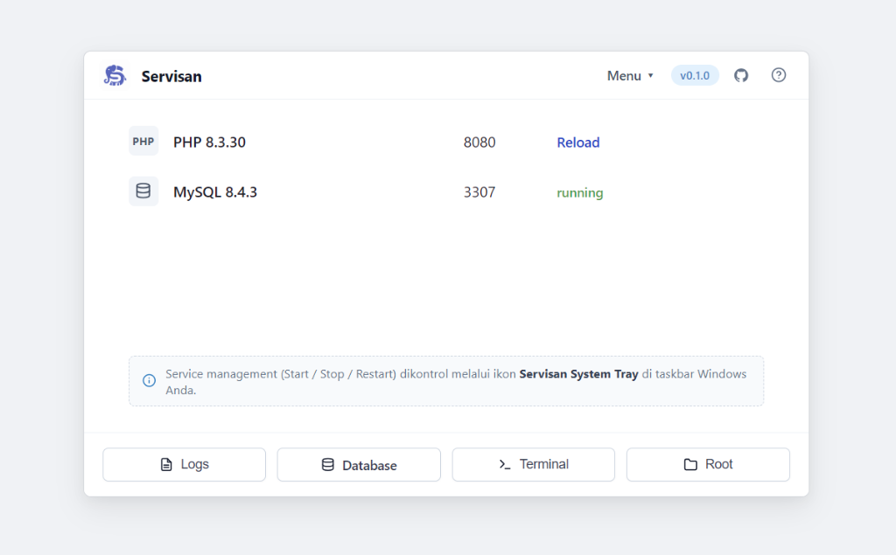

<div align="center">


# Servisan

**Ultra-lightweight, portable, and blazing-fast local PHP + MySQL server manager for Windows, crafted in Rust.**

[](CHANGELOG.md)
[](https://github.com/Haniel26/servisan)
[](https://www.rust-lang.org)
[](LICENSE)
[](#-why-servisan-vs-alternatives)
[](#-architecture)

<br><br>



<br><br>

[Key Features](#-key-features) •
[Why Servisan?](#-why-servisan-vs-alternatives) •
[Architecture](#-architecture) •
[Quick Start](#-quick-start) •
[CLI Reference](#-cli-reference) •
[Configuration](#-default-configuration) •
[Roadmap](#-roadmap) •
[Changelog](CHANGELOG.md)

</div>

---

## 💡 What is Servisan?

**Servisan** is a modern, high-performance, and completely portable alternative to legacy local server environments like Laragon and XAMPP. Built from the ground up in **Rust**, it orchestrates native **PHP** and **MySQL/MariaDB** runtimes inside a self-contained directory with zero Windows registry pollution, instant startup, and foolproof process cleanup.

The name blends **Server** + Laravel's **Artisan**, while paying homage to the Indonesian term *"servisan"*—a finely tuned, reliable mechanism.

---

## ✨ Key Features

* 🚀 **Blazing Fast & Featherweight:** Manager executable starts in under 100ms with a baseline memory footprint of **< 15 MB RAM**.
* 🖥️ **Modern Native Web Dashboard:** Curated native developer aesthetic (`#eef1f6`, clean card container, monochrome SVG stroke icons) with real-time PHP & MySQL status indicators, port chips, in-browser log console, phpMyAdmin, and direct native triggers for Terminal and Explorer.
* ⚡ **1-Click PHP Version Manager & Switcher:** Seamlessly discover installed runtimes (`bin/php/*` and Laragon), download official PHP versions (8.5 Latest, 8.4, 8.3, 8.2, 8.1, 7.4) with live byte-level progress tracking, switch active runtimes on the fly, and inspect CVE security advisories.
* 🌐 **Virtual Hosts & External Project Linking:** Link projects from external directories (`D:\Project\...`) without duplicating files using non-admin Windows Directory Junctions. Enjoy dual access via local domain (`http://app.test:8080`) and subfolder (`http://localhost:8080/app/`), automatic Laravel `public/index.php` detection, and safe Windows `hosts` synchronization.
* 📁 **100% Pure User Project `www/` Root:** The Servisan Web Dashboard is completely isolated inside `dashboard/` and served via a dynamic router, ensuring `www/` is strictly reserved for your applications without internal asset collisions.
* 🛡️ **Zero Zombie Processes & 1-Click Full Shutdown:** Controlled via native **Windows Job Objects** (`JOB_OBJECT_LIMIT_KILL_ON_JOB_CLOSE`). Shut down all services (MySQL, PHP, background tray) and close the dashboard tab with a single click.
* 📦 **100% Portable & Isolated:** Data (`data/`), logs (`logs/`), configurations (`config/`), and projects (`www/`) live strictly inside the Servisan folder. Put it on a USB drive or move folders freely without reconfiguring.
* 🎛️ **Silent System Tray (No Window / No Black Console):** Runs unobtrusively in the Windows notification area (near the clock) with dynamic status indicators. Never clutters your taskbar with open windows or black terminal popups.
* 🔀 **Conflict-Free Ports by Default:** Defaults to PHP **8080** and MySQL **3307** so you can run Servisan side-by-side with Laragon, Docker, or IIS without port clashes.
* 💻 **Built-in Developer Shell:** `servisan shell` immediately launches your terminal with Servisan's portable `php`, `mysql`, and `mysqladmin` injected directly into `PATH`.
* 🔄 **Automated Database Migration (Zero-Touch Autopilot):** Seamlessly scan and migrate all your databases from Laragon, XAMPP, or WAMP into Servisan with 1-click. Even if Laragon/XAMPP is stopped or broken, Servisan automatically spawns an ephemeral background MySQL instance on a temporary port without requiring passwords!
* 🗄️ **phpMyAdmin Ready:** One command (`servisan phpmyadmin install`) imports and configures a managed phpMyAdmin dashboard with automated blowfish secret generation.

---

## 📊 Why Servisan vs Alternatives?

| Feature | Servisan (Rust) 🦀 | Laragon | XAMPP | Docker Desktop |
| :--- | :---: | :---: | :---: | :---: |
| **Manager Private RAM** | **~4–15 MB** *(Measured)* | ~30–55 MB | ~15–25 MB *(Control Panel)* | ~500 MB–1.5 GB *(GUI)* |
| **Stack Engine RAM** | **Minimal (~80–120 MB)** | ~180–300 MB *(Apache+MySQL)* | ~200–350 MB *(Apache+MySQL)* | 2–4 GB *(WSL2 Linux VM)* |
| **Startup Latency** | **Instant (< 100ms)** | Moderate (~2–4s) | Moderate (~2–4s) | Very Slow (15–30s) |
| **Orphan Process Cleanup** | **Windows Job Object (Guaranteed)** | Sometimes leaks | Frequently leaks (*port locked*) | Container daemon |
| **PHP Version Switching** | **1-Click Download & Hot-Swap** | Manual ZIP & folder extraction | Reinstall required | Rebuild Dockerfile |
| **External Projects & VHosts** | **Link any folder via Junctions (`*.test`)** | Restricted to `laragon/www` | Manual Apache & hosts config | Volume mounts & reverse proxy |
| **Database Migration** | **1-Click Autopilot (Headless MySQL)** | Manual SQL dump & import | Manual SQL dump & import | Complex volume mapping |
| **CVE Security Advisories** | **In-App Detection & Warnings** | None (Silent) | None (Silent) | Docker Scout *(Paid/Login)* |
| **Distribution Size** | **85 MB (Setup) / 173 MB (Zip)** | ~147–173 MB | ~150 MB | ~530 MB *(+ 2 GB VM)* |
| **License & Source** | **Open Source (MIT)** | Closed-source Pascal | C / Apache (Legacy) | Proprietary Client |

---

## 🏗️ Architecture

Servisan manages independent native processes without compiling PHP or MySQL into the Rust binary, keeping upgrades trivial:


---

## 🚀 Quick Start

### Option 1: Setup Installer (.exe) or Standalone Portable (.zip)

> [!TIP]
> **Zero Dependencies:** Both packages are 100% self-contained with PHP 8.3 and MariaDB 11.4 LTS runtime. Works immediately on **any Windows PC**—even if Laragon, XAMPP, or Docker was never installed.

- **Setup Installer (`servisan-v*-setup.exe`)**: Easy one-click setup wizard that installs Servisan to `C:\Servisan` with optional Desktop shortcut and automatic startup.
- **Standalone Portable (`servisan-v*-portable.zip`)**: Zero installation required. Simply extract the archive anywhere (e.g. `D:\Servisan`, `C:\Servisan`, or a USB drive) and run `servisan.exe`.

1. Download your preferred package from [GitHub Releases](https://github.com/Haniel26/servisan/releases).
2. Launch `servisan.exe` (or run the installer).
   > [!NOTE]
   > **Runs in System Tray:** Servisan operates without opening an intrusive desktop window or black console popup. It sits quietly in the **Windows System Tray** (notification area near the clock, or inside the `^` overflow arrow).
4. The tray icon lights up green (🟢) and automatically opens `http://127.0.0.1:8080/` in your default browser. Right-click the tray icon at any time to start/stop services, open folders, or access phpMyAdmin.

---

### Option 2: From Source (Developers)

#### Prerequisites
* Windows 10/11 64-bit
* [Rust toolchain](https://rustup.rs/) (stable)
* *(Optional)* Existing Laragon installation at `C:\laragon` or `D:\laragon`

#### Setup Steps

1. **Clone the repository:**
   ```powershell
   git clone https://github.com/Haniel26/servisan.git
   cd servisan
   ```

2. **Stage portable PHP & MySQL binaries:**
   ```powershell
   .\scripts\install-binaries.ps1
   ```
   *Auto-detects Laragon on `C:\laragon` or `D:\laragon` for instant setup. If Laragon is not installed, it automatically downloads official clean portable runtimes (PHP 8.3 & MariaDB/MySQL).*

3. **Initialize environment & database storage:**
   ```powershell
   cargo run -- init
   ```

4. **Run in foreground (CLI Mode):**
   ```powershell
   cargo run -- start
   ```
   Visit `http://127.0.0.1:8080/`. Press `Ctrl+C` to cleanly terminate all services.

5. **Build optimized release binary:**
   ```powershell
   .\scripts\build-release.ps1
   .\servisan.exe status
   ```

6. **Launch System Tray mode:**
   ```powershell
   .\servisan.exe
   ```

---

## ⌨️ CLI Reference

```text
servisan [COMMAND] [OPTIONS]
```

| Command | Description |
|---|---|
| *(no command)* or `tray` | Start the system tray application (default mode) |
| `start [--only php\|mysql]` | Start services in foreground and block until `Ctrl+C` |
| `stop` | Gracefully shut down all Servisan-managed processes |
| `status` | Display running status, active ports, and datadir health |
| `init` | Initialize directories, `config/app.toml`, `php.ini`, `my.ini`, and MySQL datadir |
| `shell [--program cmd\|powershell]` | Launch terminal with Servisan's `php`, `mysql`, and `mysqladmin` on `PATH` |
| `php list [--json]` | List installed PHP runtimes, active status, and CVE security advisories |
| `php switch <target>` | Switch active PHP runtime by candidate ID, version, or folder path |
| `php install <ver> [--switch]` | 1-click download & configure official PHP from windows.php.net (8.5 to 7.4) |
| `php remove <target>` | Safely uninstall an inactive PHP runtime from `bin/php/` |
| `vhost list [--json]` | List all registered virtual hosts and external linked projects |
| `vhost add <path> [--name] [--domain]` | Link external project as virtual host with auto-detected public root |
| `vhost remove <target>` | Safely remove virtual host junction and clean up hosts file |
| `migrate scan [--from <path>]` | Auto-detect local Laragon/XAMPP/WAMP servers or scan custom folder |
| `migrate list [--from <path>]` | Inspect discovered databases and estimated storage footprints |
| `migrate import [DATABASES...]` | Import databases with zero-touch autopilot or overwrite options |
| `phpmyadmin install [--force]` | Import and configure phpMyAdmin from local Laragon directory |
| `phpmyadmin open` | Launch phpMyAdmin directly in your default browser |
| `phpmyadmin status` | Check phpMyAdmin installation status and access URL |

---

## ⚙️ Default Configuration

Configuration is stored in [config/app.toml](file:///d:/Project/ServiSan/config/app.toml):

```toml
[general]
web_root = "www"
host = "127.0.0.1"
auto_open_browser = true
auto_start_all = true

[php]
version = "php-8.3.36-Win32-vs16-x64"
engine = "builtin"
port = 8080
workers = 4

[mysql]
version = "mysql-8.4.3-winx64"
port = 3307
# Local-development memory profile: disables performance_schema,
# lowers InnoDB buffers, and caps local connections.
low_memory = true

[phpmyadmin]
enabled = true
# Optional: auto-detects C:\laragon or D:\laragon if empty, or specify custom path
source = ""
```

---

## 🗺️ Roadmap

### Completed (v0.1.x & v0.2.0)
- [x] Core CLI & process management (`init`, `start`, `stop`, `status`, `shell`)
- [x] Robust Windows process safety via Job Objects (`KILL_ON_JOB_CLOSE`)
- [x] Single-Instance enforcement with Windows named mutex (no duplicate tray icons)
- [x] Dual-distribution packaging (portable `.zip` & Inno Setup `.exe`) with app-local VC++ runtimes
- [x] Modern native developer Web Dashboard (`dashboard/`) with isolated router, keeping `www/` 100% pure
- [x] 1-Click graceful shutdown engine terminating MySQL, PHP, background tray, and closing browser tab
- [x] Automatic GitHub update detection & interactive 1-click download modal
- [x] Multi-worker concurrency for PHP built-in server (`PHP_CLI_SERVER_WORKERS`)
- [x] App-local OPcache optimization with Windows ASLR crash resiliency
- [x] **1-Click PHP Version Manager, Switcher & In-App Upgrader (`servisan php`)**:
  - [x] Multi-version discovery across `bin/php/*` and Laragon installations on all drives
  - [x] Official downloads from `windows.php.net` (PHP 8.5 Latest, 8.4, 8.3, 8.2, 8.1, 7.4)
  - [x] Real-time byte-level download progress tracker, elapsed timer & animated progress bar
  - [x] Active CVE security advisory inspection and upgrade recommendation
  - [x] Safe 1-click uninstaller for unused runtimes (preserving active PHP and user data)
- [x] **Virtual Host & External Project Manager (`servisan vhost`)**:
  - [x] Link external project directories (`D:\Project\...`) via Windows Directory Junctions (zero admin rights)
  - [x] Dual access: local domain (`http://app.test:8080`) and local subfolder (`http://localhost:8080/app/`)
  - [x] Automatic framework detection (`public/index.php` for Laravel/Symfony vs standard PHP)
  - [x] Safe Windows `hosts` file synchronizer with marker blocks and UAC elevation fallback
- [x] **Automated Database Migration Engine (`servisan migrate`)**:
  - [x] Auto-detection of local servers across all Windows drive letters (Laragon, XAMPP, WAMP, custom)
  - [x] Zero-Touch Autopilot: Headless temporary `mysqld` background spawner for offline/stopped servers
  - [x] Custom folder source picker (`--from <path>`) for external drives or moved installations
  - [x] Interactive Database Migration Wizard in Web Dashboard with real-time console & storage sizing
  - [x] Strict Zero-Emoji UI policy with clean monochrome SVG stroke icons
  - [x] Dynamic environment variables injection (`SERVISAN_MYSQL_PORT`, `SERVISAN_VERSION`) & PHP 8.1+ exception safety

### Phase 2: Independent Toolchain & Distribution (v0.3.0)
- [ ] Bundled Composer (`composer.phar` / `composer.bat`) on PATH for out-of-the-box Laravel tooling
- [ ] Official phpMyAdmin auto-download & ultra-lightweight Adminer (~500KB) support (100% decoupling from Laragon)
- [ ] **Smart Port Auto-Detection & Priority Selection**: Probe standard ports 80 & 3306 first, with graceful fallback to 8080 & 3307 if Laragon/IIS is running, plus 1-click port switcher in Web Dashboard
- [ ] **1-Click Bug Reporting & Diagnostics**: Pre-filled GitHub Issue generator in Web Dashboard and Tray with sanitized diagnostic logs and Windows environment details
- [ ] Official Winget package submission (`winget install Haniel26.Servisan`) & Scoop manifest

### Phase 3: Enhanced Virtual Hosts & Local Routing (v0.4.0)
- [ ] Built-in lightweight Rust reverse proxy routing port 80 to project public roots (e.g. `www/blog/public`)
- [ ] Automatic zero-port domain resolution (`http://app.test` without `:8080`)
- [ ] Zero Apache/Nginx dependency to preserve the ultra-lightweight memory footprint
- [ ] Opt-in automatic crash reporting & health telemetry (Sentry / webhook integration) to proactively track runtime errors

### Phase 4: Laravel Developer Experience & Scaffolding (v0.5.0)
- [ ] One-command project creation: `servisan new <app>` (runs `composer create-project`, configures database, and registers `<app>.test`)
- [ ] Background worker controls from tray context menu (`php artisan queue:work` & schedule runner)
- [ ] One-click PHP version switcher via tray menu

---

## 🔒 Security Notice

Servisan is strictly designed for **local development environments**:
* MySQL binds strictly to loopback (`127.0.0.1`).
* Default user `root` is created with no password for rapid local iteration.
* Sensitive state, database tables, credentials, and logs are strictly gitignored.

---

## 📄 License

Distributed under the **MIT License**. See [LICENSE](LICENSE) for details.

*Note: Reusing PHP and MySQL binaries redistributed alongside portable packages is governed by their respective licenses (PHP License and GNU GPL / Oracle MySQL FOSS License Exception).*